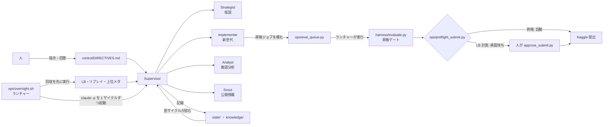

# kaggriculture-agent-loop

Kaggle のシミュレーションコンペ [Kaggriculture](https://www.kaggle.com/competitions/kaggriculture)（2 人対戦の農場経営ゲーム）を題材に、**Claude Code のサブエージェント群で「仮説 → 実装 → 評価 → 提出 → 回収 → 学習」の開発ループを夜間無人で回す仕組み**を設計・運用した記録です。

> **English summary** — An autonomous development loop built on Claude Code subagents (Supervisor + Strategist / Implementer / Evaluator / Analyst / Operator / Scout) that iterated on a pure-Python game agent for a Kaggle simulation competition: 63 agent generations and 62 experiment records over three weeks of overnight unattended runs, with machine-checked promotion gates, a human approval queue, and file-based memory so that every session can restart from the repository alone. Documentation is in Japanese. The loop was retired on 2026-09-20 when I merged into another team; leaderboard results up to that point were modest (see "結果"); the subject of this repository is the loop itself and what running it taught me.

このリポジトリは、作業用リポジトリから公開できる部分だけを取り出したものです（履歴は引き継いでいません。除いたものは末尾）。

## 何を作ったか

2 層構成です。

- **L1: 開発ループ**（このリポジトリの大半）。Claude Code のメインセッションが Supervisor になり、6 つのサブエージェントに委譲する。
- **L2: 提出物**（`agents/genNNNN/main.py`）。対戦環境にはネットワークが無く 1 ターン 1 秒の制限があるので、LLM は載せず標準ライブラリだけの Python で書く。L1 が世代を重ねて改良する。



| 役割 | 定義 | 仕事 |
| --- | --- | --- |
| Supervisor | メインセッション（[CLAUDE.md](CLAUDE.md)、[ops/NIGHTLY.md](ops/NIGHTLY.md)） | 進行管理、委譲、記録 |
| Strategist | [.claude/agents/strategist.md](.claude/agents/strategist.md) | ゲームの経済構造にもとづく仮説の立案 |
| Implementer | [.claude/agents/implementer.md](.claude/agents/implementer.md) | 新世代の実装、スモーク、プロファイル |
| Evaluator | [.claude/agents/evaluator.md](.claude/agents/evaluator.md) | 評価の実行と、評価手続きそのものの点検 |
| Analyst | [.claude/agents/analyst.md](.claude/agents/analyst.md) | 負け試合と上位同士の試合の解剖 |
| Operator | [.claude/agents/operator.md](.claude/agents/operator.md) | 提出と回収、提出枠の管理 |
| Scout | [.claude/agents/scout.md](.claude/agents/scout.md) | 公開情報と上位メタの定点観測 |

## 設計上の要点

**記憶はファイルが正、コンテキストは使い捨て。** 各サイクルは独立した `claude -p` セッションで、毎回リポジトリから状態を組み立て直します。読む順番は [CLAUDE.md](CLAUDE.md) の冒頭に固定してあります（人の指示 → 100 行以内の引き継ぎ [state/HANDOFF.md](state/HANDOFF.md) → 要件 → 直近の実験記録）。

**LLM を待ち時間に使わない。** 評価は 1 本 14 分かかる CPU 処理です。当初は 8 サイクル中 5 サイクルが評価の完了待ちで消えていたので、サイクルは [ops/eval_queue.py](ops/eval_queue.py) にジョブを積んで終わり、ランチャー [ops/overnight.sh](ops/overnight.sh) が裏で実行する形に変えました。

**昇格は統計的なゲートで機械判定する。** [harness/evaluate.py](harness/evaluate.py) は候補と現王者を同じ相手・同じシードで対戦させ、対応付きの差に信頼区間を付けます。昇格条件は「マージン差の CI 下限 > 0」または「レーティング差の CI 下限 > 0 かつマージンが非負」。シード数の規約（打ち切り 12 / 方向判断 24 / 昇格 50）は実測から決めました（[knowledge/analysis/2026-09-05_seed-detection-limit.md](knowledge/analysis/2026-09-05_seed-detection-limit.md)）。

**無人提出の安全装置。** 提出はすべて [ops/preflight_submit.py](ops/preflight_submit.py) を通します。

- `control/SUBMIT.lock` があれば提出しない（人がいつでも止められる）
- 提出物の AST 検査（[ops/static_check.py](ops/static_check.py)。標準ライブラリのみ、I/O なし）
- 昇格前に別系統モデル（Codex）のクロスレビューが必須。記録に書かれた SHA-256 が現在のコードと一致しなければ拒否（[knowledge/REVIEW_CHECKLIST.md](knowledge/REVIEW_CHECKLIST.md)）
- 評価結果が良すぎるときは別シード帯での再評価を要求（`too_good`）
- 「昇格」は自動、「LB での計測目的の提出」は人の承認制（[ops/approve_submit.py](ops/approve_submit.py)）
- 夜間のコスト上限と稼働時間上限。集計に失敗したら新しいサイクルを始めない

**人の介入点を 1 か所に集める。** 人からの指示とエージェントからの質問は [control/DIRECTIVES.md](control/DIRECTIVES.md) に書き、サイクルは最初にそこを読みます。通知は入れず、承認待ちや警告は日次レポート（[state/reports/](state/reports/)）の先頭に出します。

**同じ失敗を繰り返さないための台帳。**

- [knowledge/IDEA_POLICY.md](knowledge/IDEA_POLICY.md): 出してよい仮説と出さない仮説（定数の微調整を禁止）
- [knowledge/experiments/CLOSED.md](knowledge/experiments/CLOSED.md): 閉じた系統と、その根拠の数字
- [knowledge/FIXES.md](knowledge/FIXES.md) と [ops/check_fixes.py](ops/check_fixes.py): 世代から独立した修正台帳。非昇格の世代に入れた修正が世代交代で消える問題への対処
- [state/retro/](state/retro/): 3 夜ごとの振り返り

## 結果

このループによる攻略は 2026-09-20 の記録を最後に終了しました。その後、別のチームとマージしたためです。以下の数字はすべて終了時点（2026-09-20）のもので、マージ後のチームの成績はこのリポジトリの対象外です。

**運用の規模**

- 2026-08-30 から 09-20 まで。エージェント 63 世代、実験記録 62 件、日次レポート 13 本
- 記録が残っている夜間実行は 11 夜・91 セッション。API 換算のコストは合計約 $530、1 夜あたり $4〜$88（サブスクリプション枠内での実行で、実際の課金額ではありません。[ops/token_log.jsonl](ops/token_log.jsonl)）

**ローカル評価では前進した**

- 王者の系譜 gen0051 → gen0062 の累積で、対応付きマージン +$8,121（95% CI [+7,270, +8,973]、50 シード）。評価に使っていない別のシード帯で測った値で、元のシード帯の +$8,141 と一致しました（[state/HANDOFF.md](state/HANDOFF.md)）

**リーダーボードでは伸びなかった**

- ループが作った世代（提出した 18 世代）の LB スコアは、最高でも 802.1（gen0052、2026-09-09。当時の全体中央値は約 795、順位は上位 49.8%）で、中央値付近が上限でした。最後の観測（09-19）では 313 から 765 の範囲で、中央値（約 780）を下回っています（[ops/ratings_log.jsonl](ops/ratings_log.jsonl)、[ops/lb_rank_log.jsonl](ops/lb_rank_log.jsonl)）
- ローカルの相手プールのうち強い帯（公開ノートブック由来の上位エージェント）への勝率は、最後の王者でも 0.7% でした
- 記録中に出てくるアカウントの順位（2557 位 / 9597 チーム、スコア 1509）は、公開ノートブック由来のエージェントを手動で提出したもので、このループの成果ではありません

**そこから分かったこと**

- 最初の 19 世代は LB が 559 のまま動かなかった。原因は評価の相手が自分の系統と弱いベースラインだけだったことと、仮説が定数の微調整ばかりだったこと。要件定義を改訂し（[REQUIREMENTS.md](REQUIREMENTS.md) の v0.5、v0.6）、相手プール・ゲート・仮説の制約を入れ直した
- LB スコアは同じ提出でも中央値 12 点、最大 90 点動く。数百ドルの改善を実戦の勝敗から検出するには数万試合が必要で、LB では原理的に確かめられない（[knowledge/analysis/2026-09-10_metric-audit.md](knowledge/analysis/2026-09-10_metric-audit.md)）
- 上位はトップ選手のリプレイを写した固定行動列と公開状態による分岐が主流で、ゼロから規則を積み上げる方式は最後まで届かなかった
- エージェントが自分の結論を撤回した例が複数ある。「王者は相手の稼ぎを削る型」という分析は、追試を事前登録して別シード帯で回したところ再現せず、取り下げた（[knowledge/analysis/2026-09-20_production-vs-denial.md](knowledge/analysis/2026-09-20_production-vs-denial.md)）
- 人の承認待ちを作ったのに、それが人の読む場所に表示されず 9 日間提出が止まった（[state/retro/2026-09-18.md](state/retro/2026-09-18.md)）

## リポジトリの歩き方

| 見たいもの | 場所 |
| --- | --- |
| 要件定義と改訂の経緯 | [REQUIREMENTS.md](REQUIREMENTS.md) |
| セッションが従う運用ルール | [CLAUDE.md](CLAUDE.md) |
| 夜間サイクルの指示書 | [ops/NIGHTLY.md](ops/NIGHTLY.md)、[ops/WRAPUP.md](ops/WRAPUP.md) |
| ランチャー | [ops/overnight.sh](ops/overnight.sh) |
| 評価ハーネス | [harness/](harness/) |
| 提出まわり | [ops/preflight_submit.py](ops/preflight_submit.py)、[ops/test_submit_guards.py](ops/test_submit_guards.py) |
| 実験記録 | [knowledge/experiments/](knowledge/experiments/) |
| 実測メモと分析スクリプト | [knowledge/analysis/](knowledge/analysis/) |
| 経緯の全文 | [state/STATUS.md](state/STATUS.md) |
| 各世代のコードと仮説 | `agents/genNNNN/main.py`、`meta.json` |

## 動かすには

```bash
python3.11 -m venv .venv
.venv/bin/pip install kaggle-environments==1.32.7
.venv/bin/python harness/run_match.py agents/gen0062/main.py starter --seed 42
.venv/bin/python ops/test_eval_queue.py
```

`ops/test_submit_guards.py` は git 管理外の評価結果（`records/eval_*.json`）を入力に使うので、公開版だけでは動きません。プール評価（`harness/evaluate.py --pool control/sparring_pool.json`）は、公開版に含めていないスパーリング相手が必要です。入手元は [agents/sparring/README.md](agents/sparring/README.md) にあります。提出・回収のスクリプトは Kaggle の認証情報とコンペへの参加が前提で、コンペ終了後は動きません。

## 公開版で除いたもの・変えたもの

- 他の参加者のコード（スパーリング用に取得した公開ノートブックのエージェント 10 体）と、Kaggle Discussion の原文コーパス
- 非公開の参照資料にもとづく計画書 1 件
- 対戦結果・リプレイ・ログなどの生成物（もともと git 管理外）
- 個人環境のパス、ホスト名、アカウント名、セッション ID は書き換えまたは伏せ字。提出 ID は提出ごとに一貫した仮名（`sub-01` など）に置換
- 文中の `../personal`（作者個人の手動開発用ディレクトリ）と `../shared`（共通知見の置き場）、Claude Code のスキル `codex-review` はこのリポジトリの外にあります

記録中に出てくる他の参加者の名前は、公開リーダーボードと公開ノートブックの著者名です。

## ライセンス

[MIT](LICENSE)
